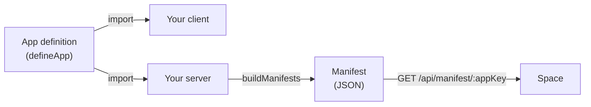

## What an app definition is

An app definition is one TypeScript object, built with `defineApp`, that describes your app to [Space](./glossary.md#space).
You write it once: your server and client import it, and your server builds the [manifest](./glossary.md#manifest) that Space reads from it.

It declares the app `key`, its pages (one screen each, with a path), the [capabilities](./glossary.md#capability) it can be granted and the resources it needs. It does not read environment variables, so the server and the client import the same object.

One page gated by one capability.

```ts title="src/app.definition.ts"
import { defineApp } from '@vectoragents/vs-apps';

export const definition = defineApp({
  key: 'hello-app', // sent to Space as appKey
  name: 'Hello app',
  version: '0.1.0',
  pages: [
    {
      key: 'home',
      label: 'Home',
      path: '/',
      capability: 'hello:view', // gates the page; must match a key below
    },
  ],
  capabilities: [
    { key: 'hello:view', label: 'View hello', effect: 'read' },
  ],
});
```

The definition and the manifest are two different things.

| | Definition | Manifest |
| --- | --- | --- |
| Form | Hand-written TypeScript | Generated JSON |
| Built by | You | `buildManifests` in `@vectoragents/vs-apps/server` |
| Read by | Your server and client, in-process | Space, over HTTP at `GET /api/manifest/:appKey` |

Space never sees the definition. It reads only the manifest the server builds from it.

## What an app definition does

One definition is used in ten places, in three groups: on import and in the client, in your server and in Space.



### On import and in the client

1. **Validate on import.** `defineApp` checks the fields when the file is imported. If a field breaks a rule, the import throws and the server does not start. It returns the input unchanged.
2. **Type navigation and routes.** The client lists pages with `appPages(...)` and derives a path type from the declared paths. No route is generated or guarded from the definition.

### In your server

3. **Generate and serve the manifest.** `buildManifests` turns each definition into a manifest at boot. The server serves it each time Space reads the manifest.
4. **List agent-callable routes.** Routes the server marks as agent-callable are listed in the manifest at boot.
5. **Merge the [agent catalog](./glossary.md#agent-catalog).** At boot, the build-time agent catalog is merged into the manifest, joined on page keys.
6. **Keep the server's app registry.** The registry is the server's list of app definitions. The server holds each definition beside its server module, mounts the module and serves the definition's manifest.
7. **Check the token.** Controllers compare the `appKey` in a Space token with the definition `key` before they answer.
8. **Register connector event handlers.** A [connector slot](./glossary.md#connector-slot) declares handler keys in the definition. Register a handler for every declared handler key. The [software development kit (SDK)](./glossary.md#sdk) acknowledges an unregistered handler as `{ handled: false }` and never retries it.
9. **Look up a model slot.** Code asks Space for a model by [model slot](./glossary.md#model-slot) key. The SDK refuses a slot that the manifest does not declare. If no one sets a slot, the SDK refuses it too.

### In Space

10. **Read the manifest in Space.** Space turns the manifest into these:

    | Manifest field | Space shows |
    | --- | --- |
    | Pages | Navigation entries |
    | Capabilities | The capabilities a [space manager](./glossary.md#space-manager) can grant |
    | Resources | A configuration sheet |
    | Agents and [Model Context Protocol (MCP)](./glossary.md#mcp) servers | Subagents and connectors |

See [How it reflects in Space](#how-it-reflects-in-space).

## How to write one

Prerequisites: `@vectoragents/vs-apps` 0.2.4 installed.

To fill in a definition from a form instead, use the [definition builder](/builder).

### Core fields

`defineApp` does not reject unknown top-level keys. TypeScript flags them at compile time.

| Field | Required | Rule |
| --- | --- | --- |
| `key` | required | Lower kebab-case, 2-63 characters, starts with a letter. |
| `name` | optional | Display name, 1-80 characters. |
| `version` | required | Non-empty string. Not checked as semver. |
| `pages` | required | At least one page. Array order is navigation order. |
| `defaultPageKey` | optional | When set, must equal a declared page key. |
| `capabilities` | required | Array of capabilities. `capabilities: []` is valid. |
| `resources` | optional | Object. Declares what the app needs from each Space. |

### `pages[]`

| Field | Required | Rule |
| --- | --- | --- |
| `key` | required | Lower kebab-case. Unique within the app. Checked by `buildManifests`, not at import. |
| `label` | required | Non-empty string. |
| `path` | required | String that starts with `/`. |
| `capability` | optional | One capability key. A page without a capability has no gate. |

:::warning
`defineApp` does not check `pages[].capability` against `capabilities`. A typo such as `hello:veiw` passes import and fails only when a user holds no matching capability. Define each key once and reuse it, as in the example below. Then TypeScript reports a typo.
:::

One key, used in the page and in the capability.

```ts title="src/app.definition.ts"
import { defineApp } from '@vectoragents/vs-apps';

const cap = { view: 'hello:view' } as const;

export const definition = defineApp({
  key: 'hello-app',
  version: '0.1.0',
  pages: [{ key: 'home', label: 'Home', path: '/', capability: cap.view }],
  capabilities: [{ key: cap.view, label: 'View hello', effect: 'read' }],
});
```

### `capabilities[]`

| Field | Required | Rule |
| --- | --- | --- |
| `key` | required | Form `<group>:<action>`, lower kebab-case segments. Two or more segments are valid. |
| `label` | required | Non-empty string. |
| `description` | optional | String. |
| `effect` | required | `"read"` or `"write"`. |

### Resources

`resources` is optional and declares what the app needs from each Space: modules, model slots and connector slots. Each of `modules`, `models` and `connectors` is optional. Unknown keys are rejected. Each slot or module `key` is unique within its list.

```ts title="src/app.definition.ts"
import { defineApp } from '@vectoragents/vs-apps';

export const definition = defineApp({
  key: 'support-app',
  version: '0.1.0',
  pages: [{ key: 'inbox', label: 'Inbox', path: '/inbox', capability: 'support:read' }],
  capabilities: [{ key: 'support:read', label: 'Read inbox', effect: 'read' }],
  resources: {
    modules: [{ key: 'knowledge', required: false }],
    models: [
      {
        key: 'summary',
        modality: 'chat',
        providers: ['ANTHROPIC'],
        required: true,
      },
    ],
    connectors: [
      {
        key: 'whatsapp',
        provider: 'REST',
        required: true,
        eventHandlers: [{ key: 'message', label: 'Incoming message' }],
      },
    ],
  },
});
```

#### `resources.modules[]`

| Field | Required | Rule |
| --- | --- | --- |
| `key` | required | Non-empty string. Unique within modules. |
| `required` | required | Boolean. |
| `label` | optional | Display label. |

#### `resources.models[]`

| Field | Required | Rule |
| --- | --- | --- |
| `key` | required | Lower kebab-case slot key. |
| `modality` | required | Kind of model: `"chat"`, `"vision"`, `"embed"` or `"rerank"`. |
| `providers` | required | At least one of `ANTHROPIC`, `AZURE_OPENAI`, `COHERE`, `AZURE_DOCUMENT_INTELLIGENCE`. |
| `label` | optional | Display label. Falls back to the slot key. |
| `description` | optional | String. |
| `models` | optional | Exact model ids, as the provider names them. At least one when set. |
| `capabilities` | optional | Each one of `toolCalling`, `structuredOutput`, `reasoningOutput`, `promptCaching`, `streaming`. |
| `required` | required | Boolean. |

#### `resources.connectors[]`

A slot takes one connector.

| Field | Required | Rule |
| --- | --- | --- |
| `key` | required | Lower kebab-case slot key. |
| `provider` | required | One of `REST`, `GRAPHQL`, `MCP`, `GOOGLE`, `CLICKUP`, `EXA`, `FIRECRAWL`, `INSTANTLY`, `UNIPILE`, `APOLLO`, `META`. |
| `label` | optional | Display label. Falls back to the slot key. |
| `required` | required | Boolean. |
| `eventHandlers` | optional | At least one handler when set. See the next table. |

Any handler makes `eventsUrl` required in the manifest. `buildManifests` sets it to `<publicBaseUrl>/api/events/<appKey>` unless the definition sets `eventsUrl`.

#### `resources.connectors[].eventHandlers[]`

| Field | Required | Rule |
| --- | --- | --- |
| `key` | required | Lower kebab-case handler key. Unique within the connector slot. |
| `label` | required | Non-empty string. |
| `description` | optional | String. |
| `defaultEventTypes` | optional | At least one lower-case slug when set. A type is the default of one handler only. |
| `singleEventType` | optional | Boolean. When `true`, `defaultEventTypes` holds at most one type. |

## How it reflects in Space

Vector registers your manifest URL in Space. Space stores the served manifest, never the definition file. After that:

- The page shows in the Space navigation, for users who hold the page's capability.
- A space manager grants the declared capabilities. Only declared capabilities can be granted.
- A space manager picks a model for each model slot and attaches one connector to each connector slot. If no one sets a slot, the app cannot use it.
- A manifest change waits as a pending review. Vector applies it before it goes live, unless auto-apply is on for the [app registration](./glossary.md#app-registration).

Space reads the manifest again when Vector triggers a pull and when the app announces that it started.

### SDK guarantees

- `defineApp` rejects a malformed definition at import.
- `buildManifests` builds the manifest from the definition and the server serves it at `GET /api/manifest/:appKey`.
- The SDK refuses a model slot that the manifest does not declare. If no one sets a slot, the SDK refuses it too.

### Space-side

- Registration, the pending review and auto-apply.
- Navigation entries and the capability filter on them.
- Grants, model choices and connector attachment.

## Next steps

You now know which behavior the SDK guarantees and which behavior Space owns.

- [Example app definitions](./examples.md): copy a complete definition into your project.
- [Recipes](/category/recipes): add a page, a capability or an agent action to your app.
- [Reference](/category/reference): look up the signature of each export, and the glossary terms.
