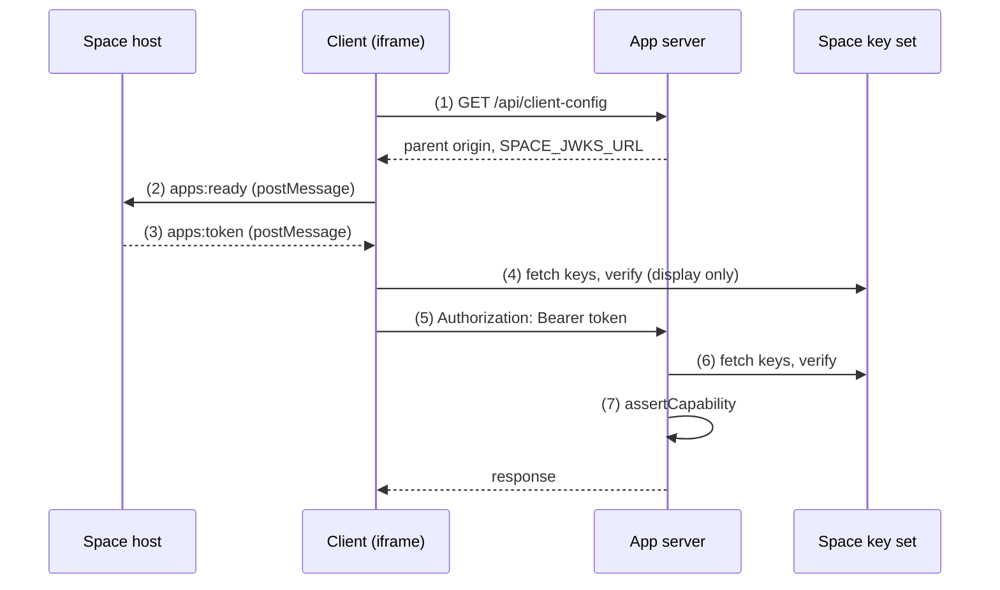
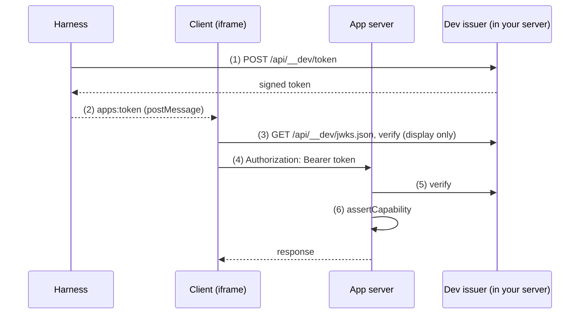

Run a small app inside a [Space](./glossary.md#space) and see the same user token verified in the browser and on your server.

import DiagramControls from '@site/src/components/DiagramControls';

## Goal

You clone a working app, run it in the [harness](./glossary.md#harness) on your machine, then ask Vector to register it so you can open it in a real Space. The app has one page, and only users who hold the `hello:view` capability, a permission that Space grants to a user, can see it.

Space signs a short-lived token, the user token, for the person who opens the page, and your app checks that token before it trusts anything in it.

After Part 1, the page runs in the harness on your machine. After Part 2, the `hello-app` page is open in a Space. It shows your user id and space id from the verified token.

<DiagramControls>



</DiagramControls>

Space mints the token and posts it to your client. Your client sends it to your server, and the server verifies it against the Space key set, the public keys that Space publishes. Only the server check protects data. Anyone can change what runs in a browser.

## Prerequisites

- [ ] Git, `npm` and the current [Node.js LTS](https://nodejs.org/en/download) release.
- [ ] A GitHub personal access token (classic) with the `read:packages` scope. [Create one](https://docs.github.com/en/authentication/keeping-your-account-and-data-secure/managing-your-personal-access-tokens#creating-a-personal-access-token-classic).

## Part 1: Run the app locally

### 1. Clone the starter and install

The starter is a working app. You start from running code instead of an empty project. Clone it, export your package token and install the dependencies. `.npmrc` reads the token from the `GITHUB_PACKAGES_TOKEN` environment variable during install.

```bash
git clone https://github.com/VectorAgents/vector-app-quickstart.git hello-app
cd hello-app
export GITHUB_PACKAGES_TOKEN=YOUR_GITHUB_PACKAGES_TOKEN
npm install
```

In PowerShell, run `$env:GITHUB_PACKAGES_TOKEN = "YOUR_GITHUB_PACKAGES_TOKEN"` instead of the `export` line.

**Check**: run `npm ls @vectoragents/vs-apps`. The command exits with 0 and shows the package in all three workspaces.

```text
hello-app@0.1.0 /path/to/hello-app
├─┬ @hello-app/client@0.1.0 -> ./client
│ └── @vectoragents/vs-apps@0.2.4
├─┬ @hello-app/server@0.1.0 -> ./server
│ └── @vectoragents/vs-apps@0.2.4 deduped
└─┬ @hello-app/shared@0.1.0 -> ./shared
  └── @vectoragents/vs-apps@0.2.4 deduped
```

The clone holds these files. The tour reads the ones that carry the token path.

```text
hello-app/
├── .env.example
├── .npmrc
├── package.json
├── client/
│   ├── harness.html
│   ├── index.html
│   ├── vite.config.ts
│   └── src/
│       ├── App.tsx
│       ├── HelloPage.tsx
│       ├── main.tsx
│       └── token.ts
├── server/
│   └── src/
│       ├── auth.ts
│       ├── dev-routes.ts
│       ├── main.ts
│       └── manifests.ts
└── shared/
    └── src/
        └── index.ts
```

### 2. Run the app in the harness

The harness stands in for Space on your machine. `npm run dev` starts the server on port 3101 and Vite on port 5173 with the harness values, and it needs no `.env`. Vite serves the client and forwards requests under `/api` to the server.

```bash
npm run dev
```

Open `http://localhost:5173/harness.html`. The harness stands in for Space: it asks the [dev issuer](./glossary.md#dev-issuer) in your server for a token for the user `dev-user` and posts the token to your page. The address `http://localhost:5173` alone stays on `Waiting for Space.`, because only the harness or Space sends a token.

<DiagramControls>



</DiagramControls>

Step (3) in the diagram produces `Verified in the browser`. Steps (5) and (6) produce `Verified on the server`.

**Check**: the page inside the harness shows three lines.

```text
Verified in the browser: user dev-user in space 1.
Capabilities: hello:view
Verified on the server: space 1, user dev-user
```

The run proves your page and your server, but not your registration or Space access. Part 2 covers those.

### 3. Read the app definition

The page in step 2 shows three lines. Steps 3 to 5 read the part of the app behind each line:

- Step 3, the app definition: declares `hello:view`, the capability in `Capabilities: hello:view`.
- Step 4, the server: produces `Verified on the server`.
- Step 5, the page: produces `Verified in the browser` and `Capabilities`.

The [app definition](./glossary.md#app-definition) names the app and lists its pages and capabilities. The server check and the page both import `CAPABILITY`. They use one capability key, `hello:view`.

```ts title="shared/src/index.ts" starter
import { defineApp } from '@vectoragents/vs-apps';

export const CAPABILITY = 'hello:view';

export const definition = defineApp({
  key: 'hello-app',
  name: 'Hello app',
  version: '0.1.0',
  pages: [
    {
      key: 'home',
      label: 'Home',
      path: '/',
      capability: CAPABILITY,
    },
  ],
  capabilities: [{ key: CAPABILITY, label: 'View hello', effect: 'read' }],
});
```

`capability` on the page must match a capability `key` exactly.

### 4. Verify the token on the server

Before any user token exists, Space and your client need facts about your app. The server answers two routes for them first. `buildManifests` turns the definition into a manifest, a JSON document that tells Space what your app contains. The server serves it to Space at `GET /api/manifest/hello-app`. Space sends a provisioning token, which proves the request comes from Space.

```ts title="server/src/manifests.ts" starter
import { buildManifests } from '@vectoragents/vs-apps/server';
import { definition } from '@hello-app/shared';

export const manifests = buildManifests([definition], {
  catalogPath: 'agent-catalog.json',
  publicBaseUrl: process.env.PUBLIC_BASE_URL ?? '',
});
```

`catalogPath` points at `agent-catalog.json`, the [agent catalog](./glossary.md#agent-catalog) file. The Hello app has no agent pages or actions. The starter ships it empty.

The auth module holds the verifier and the checks that protected routes run. `extractBearer` reads the `Authorization` header, `verifyAppUserToken` verifies the token and returns its claims, and `assertCapability` refuses a token that lacks the capability you name. The verifier reads the Space key set from `SPACE_JWKS_URL`, which Part 2 sets. In harness mode it uses `devIssuer` instead, the dev issuer that `dev-routes.ts` defines.

```ts title="server/src/auth.ts" starter
import type { IncomingMessage } from 'node:http';
import {
  assertCapability,
  createSpaceTokenVerifier,
  extractBearer,
  verifyAppUserToken,
  verifyProvisioningToken,
} from '@vectoragents/vs-apps/server';
import { devIssuer } from './dev-routes';

const verifier = devIssuer ?? createSpaceTokenVerifier({ jwksUrl: process.env.SPACE_JWKS_URL ?? '' });

export async function requireCapability(req: IncomingMessage, capability: string) {
  const claims = await verifyAppUserToken(verifier, extractBearer(req.headers));
  assertCapability(claims, capability);
  return claims;
}

export function requireProvisioning(req: IncomingMessage) {
  return verifyProvisioningToken(verifier, extractBearer(req.headers));
}
```

The `routes` object maps each path to a handler.

```ts title="server/src/main.ts" starter
const routes: Record<string, Route> = {
  '/api/client-config': async () => ({
    allowedParentOrigin: process.env.ALLOWED_PARENT_ORIGIN,
    spaceJwksUrl: devIssuer ? DEV_JWKS_PATH : process.env.SPACE_JWKS_URL,
    spaceApiUrl: process.env.SPACE_API_URL,
  }),
  '/api/manifest/hello-app': async (req) => {
    await requireProvisioning(req);
    return manifests['hello-app'];
  },
  '/api/hello': async (req) => {
    const claims = await requireCapability(req, CAPABILITY);
    return { sub: claims.sub, spaceId: claims.spaceId };
  },
  '/api/provision': async (req) => {
    await requireProvisioning(req);
    return { ok: true };
  },
  '/api/deprovision': async (req) => {
    await requireProvisioning(req);
    return { ok: true };
  },
};
```

`GET /api/client-config` tells the client which parent origin and which key set to trust. In harness mode the key set comes from `DEV_JWKS_PATH`, the route where `devIssuer` publishes its public keys. Otherwise it comes from `SPACE_JWKS_URL`. A check that fails throws an `AppAuthError`. The server replies with status 401 when the token is missing or invalid, and 403 when the token lacks the capability.

`GET /api/hello` returns the claims of a verified user token. Space calls `POST /api/provision` and `DELETE /api/deprovision` when a space manager, the person who adds apps to a Space, adds or removes the app. The harness run does not call them.

The client config also returns `SPACE_API_URL` as `spaceApiUrl`, the Space API address that your page can use. When the server starts, it also tells Space which manifests it holds. `pingSpaceManifests` sends the hash of each manifest to Space, and Space reads again a manifest that changed, so a restart refreshes the manifest in Space. The ping takes the Space origin, so the code removes `/api` from `SPACE_API_URL`. The harness has no `SPACE_API_URL`, so the harness run sends no ping.

```ts title="server/src/main.ts" starter
if (process.env.SPACE_API_URL) {
  // The ping takes the Space origin; the client directory takes the origin plus /api.
  const spaceBaseUrl = process.env.SPACE_API_URL.replace(/\/api\/?$/, '');
  void pingSpaceManifests({ spaceBaseUrl, manifests });
}
```

### 5. Read the token in the page

The page needs the token to call your server. It also reads the claims from that token to show the browser lines. `loadAppClientConfig` fetches `GET /api/client-config`. `AppProvider` starts the iframe bridge, the channel on which Space sends tokens, verifies each token Space sends and exposes the claims. `BootGate` shows `fallback` and does not show the page until the first verified token arrives.

```tsx title="client/src/App.tsx" starter
import { loadAppClientConfig } from '@vectoragents/vs-apps/client';
import { AppProvider, BootGate } from '@vectoragents/vs-apps/react';
import { HelloPage } from './HelloPage';
import { setAppToken } from './token';

const config = loadAppClientConfig();

export function App() {
  return (
    <AppProvider
      config={config}
      navigate={(path) => window.history.replaceState(null, '', path)}
      onToken={setAppToken}
      onTheme={(theme) => {
        document.documentElement.dataset.theme = theme;
      }}
    >
      <BootGate fallback={<p>Waiting for Space.</p>}>
        <HelloPage />
      </BootGate>
    </AppProvider>
  );
}
```

`onToken` is the only way to read the raw token. `token.ts` holds it in a module variable, as the package README does.

```ts title="client/src/token.ts" starter
let appToken: string | null = null;

export function setAppToken(token: string | null): void {
  appToken = token;
}

export async function fetchHello(): Promise<{ sub?: string; spaceId: number }> {
  const response = await fetch('/api/hello', {
    headers: { Authorization: `Bearer ${appToken}` },
  });
  if (!response.ok) throw new Error(`GET /api/hello failed with ${response.status}`);
  return response.json();
}
```

The page reads the claims with `useApp`. `RequireCapability` hides the content from a user who lacks `hello:view`. This client check is display only. The server check from step 4 decides.

```tsx title="client/src/HelloPage.tsx" starter
import { useEffect, useState } from 'react';
import { CAPABILITY } from '@hello-app/shared';
import { RequireCapability, useApp } from '@vectoragents/vs-apps/react';
import { fetchHello } from './token';

export function HelloPage() {
  const { claims, capabilities } = useApp();
  const [serverSaw, setServerSaw] = useState<string>('waiting for the server');

  useEffect(() => {
    fetchHello()
      .then((hello) => setServerSaw(`space ${hello.spaceId}, user ${hello.sub ?? 'unknown'}`))
      .catch((error: Error) => setServerSaw(error.message));
  }, []);

  return (
    <RequireCapability capability={CAPABILITY} fallback={<p>You do not hold {CAPABILITY}.</p>}>
      <main>
        <h1>Hello from a Vector app</h1>
        <p>Verified in the browser: user {claims?.sub ?? 'unknown'} in space {claims?.spaceId}.</p>
        <p>Capabilities: {Array.from(capabilities).join(', ')}</p>
        <p>Verified on the server: {serverSaw}</p>
      </main>
    </RequireCapability>
  );
}
```

## Part 2: Add the app to a Space

Part 2 puts the app in a real Space. Only Vector can register the app. You send the request in step 2 and cannot start step 4 until Vector confirms. Stop after Part 1 if you have no Space access. Steps 3, 4, 5 and 6 run in the Space UI.

### Before you start

A real Space needs these things in place. Check them before step 1.

- [ ] A Vector representative, the person at Vector who registers apps, to send the registration request to.
- [ ] A space to add the app to.
- [ ] An Organization admin, a member who sees **Organization** under **Settings**, to do [step 3](#3-publish-the-space-agent). A space manager to do steps 4 and 5. Anyone with Edit level on the space, the access level that lets a member edit it, and any Organization admin, is a space manager.
- [ ] The Space server can reach your server. It needs a public URL that forwards to port `3101` (`SERVER_PORT`). Keep the URL the same until Vector confirms the registration.

### 1. Point the app at your Space

Space reaches your server over the network. The server needs real addresses instead of the harness values. Stop the harness with Ctrl-C. Copy the example file, then replace the example values with your own.

```bash
cp .env.example .env
```

- `SPACE_JWKS_URL` is the address of the Space key set. The server uses it to check that a token comes from Space. It is the origin of the Space API followed by `/api/.well-known/apps/jwks.json`.
- `SPACE_API_URL` is the address of the Space API. The server uses it to ping Space at start, and the client config passes it to your page. It is the origin of the Space API followed by `/api`, for example `https://space-api.example.com/api`. Write it with no trailing slash.
- `ALLOWED_PARENT_ORIGIN` is the origin of the Space web client that embeds your page, for example `https://space.example.com`. Write it with no trailing slash and no path: the client accepts messages from an exact match only.
- `PUBLIC_BASE_URL` is the origin where the Space server reaches your server, for example `https://hello-app.example.com`. The server writes it into each `{publicBaseUrl}` placeholder in the manifest. The Hello app has no placeholder. You reuse this origin in step 2 for the manifest URL.
- `SERVER_PORT` is the port your server listens on.
- `CLIENT_PORT` is the port Vite serves the client on.

`npm run dev:space` reads `.env` and turns the harness routes off.

```bash
npm run dev:space
```

With `SPACE_API_URL` set, the server pings Space each time it starts. `npm run dev` clears `SPACE_API_URL`, so only `npm run dev:space` sends the ping. The server prints nothing when the ping works. If the ping fails, the server logs a line such as `manifest ping for "hello-app" got 500` and tries again after 5 seconds and after 15 seconds. The server keeps running in every case.

**Check**: in a second terminal, run this command. It prints the HTTP status and the first 9 characters of the response.

```bash
node --env-file=.env -e "fetch(process.env.SPACE_JWKS_URL).then((r) => r.text().then((t) => console.log(r.status, t.slice(0, 9))))"
```

```text
200 {"keys":[
```

`200 <!doctype` means `SPACE_JWKS_URL` lacks the `/api` prefix. `404` means the path is wrong. `fetch failed` means nothing listens at that address.

### 2. Ask Vector to register the app

Only Vector registers an app and allows it in an organization license. Send the request now, then do step 3 while you wait. Keep `npm run dev:space` running. Space fetches the manifest when Vector registers the app. Send Vector this information:

- The manifest URL: `PUBLIC_BASE_URL` followed by `/api/manifest/hello-app`. The Space server fetches it, so it must work from the Space server's network.
- The iframe URL: `http://localhost:` followed by `CLIENT_PORT`. Your browser loads it, so `localhost` is your own machine. It is the client origin, not the server origin.
- The name of your organization.

Space fetches the manifest with a provisioning token. The manifest route calls `requireProvisioning`, which verifies that token.

Contact your Vector representative. Vector creates the [app registration](./glossary.md#app-registration), enables it and allows it in your organization license.

**Check**: wait for Vector to confirm, then continue at step 4. **Hello app** appears in the **Add an app** dialog there.

### 3. Publish the space agent

**Role**: Organization admin.

The space switcher, the menu in which a member picks a space, lists a space only when its agent has a published version. Until then Space shows "No spaces yet" and you cannot reach your app. A new space holds a draft agent that you publish as it is. An Organization admin opens an unpublished space from the list of spaces in the organization settings.

1. Choose **Settings**, **Organization**, then **Spaces**. Choose your space.
2. Choose **Agent Studio**, then **Canvas**. If the canvas already shows **Published** and has no **Publish All** button, skip item 3.
3. Choose **Publish All**. In the **Review Changes Before Publishing** dialog, choose **Publish All**.

**Check**: Space shows the toast `All published`. The canvas shows **Published** and the date. After a reload, the space appears in the space switcher of its members.

### 4. Add the app to a space

**Role**: space manager.

Adding the app makes Space call your server. Your server must accept that call.

1. Choose **Settings**, **Space**, **Context Hub**, then **Resources**.
2. Choose **Add resource**, then **App**. In the **Add an app** dialog, choose **Add** next to **Hello app**.

The call is `POST /api/provision`. The body holds `serviceSecret`, a secret that Space creates for each pair of app and space. Your server uses it to prove its identity when it calls Space. Space treats a status outside 200 to 299, no reply within 10 seconds, or a network error as a failure, and the add fails.

**Check**: Space shows the toast `App enabled`. **Resources** lists a **Hello app** row with type **App** and status **Active**. The **Configure Hello app** sheet opens. Close it.

If the toast starts with `App secret provisioning failed`, the add failed. A number after it is the status your server sent: check that the manifest URL Vector registered is the one from step 2. No number means Space did not reach your server: check that `npm run dev:space` still runs and that the public URL still points to port `3101`.

### 5. Share the app with a user

**Role**: space manager.

A user sees the page only after the space manager shares the app with that user. **Direct access** lists only members of the space. Add the user to the space first. Skip this step if you are the space manager who added the app. You already have access.

1. Choose **Settings**, **Space**, then **Access**. Under **Members**, choose **Add** and pick the user.
2. Choose **Context Hub**, then **Resources**. On the **Hello app** row, open the row menu and choose **Access**.
3. In **Direct access**, choose **Add people, roles or groups…** and pick the user. Keep the access level at **View**, which is enough for the page. Choose **Save changes**.

**Check**: Space shows the toasts `Member added` and `Access saved`. Open the row menu and choose **Access** again. **Direct access** lists the user.

### 6. Open the page

Space renders the page in an iframe at the iframe URL. It sends a user token over `postMessage`. The page shows what the token and your server say. Open the Space. Expand the **Apps** group in the sidebar and choose **Hello app**.

**Check**: the page shows three lines, also for a user you shared the app with at the **View** level. The two user ids are equal, and the two space ids are equal.

```text
Verified in the browser: user <id> in space <id>.
Capabilities: hello:view
Verified on the server: space <id>, user <id>
```

If the page stays on `Waiting for Space.`, check three things. `ALLOWED_PARENT_ORIGIN` must be the exact origin of the Space web client, as in step 1. The iframe URL that Vector registered must be your client origin from step 2. Open the page from the **Apps** group in Space, not by its address. If the browser console shows `[apps] token verification failed`, check `SPACE_JWKS_URL`.

## Result

The `hello-app` page is open in a Space. It shows the same three lines as the last Check. Both user ids come from the one token that Space sends. Your server verified that token against the Space key set before it answered.

## Next steps

- [App definition](./app-definition.md): learn what each definition field does.
- [Recipes](/category/recipes): add a page, a capability or an agent action to this app.
- [Harness reference](./reference/harness.md): wire the harness into an app that is not built from the starter.
