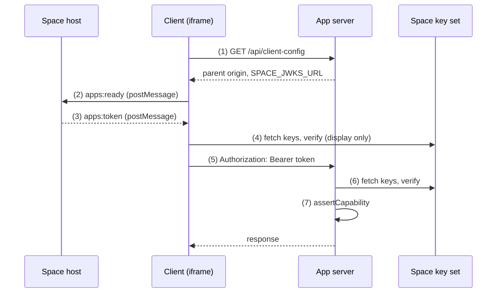

Run a small app inside a [Space](./glossary.md#space) and see the same user token verified in the browser and on your server.

## Goal

You clone a working app, run it in the [harness](./glossary.md#harness) on your machine, then ask Vector to register it so you can open it in a real Space. The app has one page, and only users who hold the `hello:view` capability, a permission that Space grants to a user, can see it.

Space signs a short-lived token for the person who opens the page, and your app checks that token before it trusts anything in it. Learn this path once and every page you add later works the same way.

After Part 1, the page runs in the harness on your machine. After Part 2, the `hello-app` page is open in a Space. It shows your user id and space id from the verified token.



Space mints the token and posts it to your client. Your client sends it to your server, and the server verifies it against the Space key set. Only the server check protects data. Anyone can change what runs in a browser.

## Prerequisites

- [ ] Git, Node.js 20.19 or later, and `npm`.
- [ ] A GitHub token with `read:packages` access to `@vectoragents/vs-apps`.

## Part 1: Run the app locally

### 1. Clone the starter and install

The starter holds a working app, so you start from running code instead of an empty workspace. Clone it, export your package token and install. `.npmrc` reads the token from `GITHUB_PACKAGES_TOKEN` at install, so the token never enters the repository.

```bash
git clone https://github.com/SajeeVeracity/vector-app-quickstart.git hello-app
cd hello-app
export GITHUB_PACKAGES_TOKEN=YOUR_GITHUB_PACKAGES_TOKEN
npm install
```

**Check**: run `npm ls @vectoragents/vs-apps`. The command exits with 0 and shows the package in all three workspaces.

```text
hello-app@0.1.0 /path/to/hello-app
├─┬ @hello-app/client@0.1.0 -> ./client
│ └── @vectoragents/vs-apps@0.2.4
├─┬ @hello-app/server@0.1.0 -> ./server
│ └── @vectoragents/vs-apps@0.2.4 deduped
└─┬ @hello-app/shared@0.1.0 -> ./shared
  └── @vectoragents/vs-apps@0.2.4 deduped
```

The clone holds these files. The steps below visit each one.

```text
hello-app/
├── .env.example
├── .npmrc
├── package.json
├── client/
│   ├── harness.html
│   ├── index.html
│   ├── vite.config.ts
│   └── src/
│       ├── App.tsx
│       ├── HelloPage.tsx
│       ├── main.tsx
│       └── token.ts
├── server/
│   └── src/
│       ├── auth.ts
│       ├── dev-routes.ts
│       ├── main.ts
│       └── manifests.ts
└── shared/
    └── src/
        └── index.ts
```

### 2. Read the app definition

Every other file follows from one file, so read it first. The [app definition](./glossary.md#app-definition) is the file that the server and the client share. [App definition](./app-definition.md) explains each field. `CAPABILITY` holds the capability key, so no file repeats the string.

```ts title="shared/src/index.ts" starter
import { defineApp } from '@vectoragents/vs-apps';

export const CAPABILITY = 'hello:view';

export const definition = defineApp({
  key: 'hello-app',
  name: 'Hello app',
  version: '0.1.0',
  pages: [
    {
      key: 'home',
      label: 'Home',
      path: '/',
      capability: CAPABILITY,
    },
  ],
  capabilities: [{ key: CAPABILITY, label: 'View hello', effect: 'read' }],
});
```

`capability` on the page must match a capability `key` exactly.

### 3. Serve the manifest and client config

Space and your client need facts about your app before any user token exists, so the server answers two routes first. `buildManifests` turns the definition into a manifest, a JSON document that tells Space what your app contains. The server serves it to Space at `GET /api/manifest/hello-app`, and Space sends a provisioning token with the request.

```ts title="server/src/manifests.ts" starter
import { buildManifests } from '@vectoragents/vs-apps/server';
import { definition } from '@hello-app/shared';

export const manifests = buildManifests([definition], {
  catalogPath: 'agent-catalog.json',
  publicBaseUrl: process.env.PUBLIC_BASE_URL ?? '',
});
```

`GET /api/client-config` tells the client which parent origin and which key set to trust. In harness mode the key set comes from the harness. Otherwise it is `SPACE_JWKS_URL`, which Part 2 sets.

```ts title="server/src/main.ts" starter
const routes: Record<string, Route> = {
  '/api/client-config': async () => ({
    allowedParentOrigin: process.env.ALLOWED_PARENT_ORIGIN,
    spaceJwksUrl: devIssuer ? DEV_JWKS_PATH : process.env.SPACE_JWKS_URL,
  }),
  '/api/manifest/hello-app': async (req) => {
    await requireProvisioning(req);
    return manifests['hello-app'];
  },
```

### 4. Verify the token on the server

The server check is the one that protects data, so the server trusts no token until it verifies the token. The auth module holds the verifier and the checks that protected routes run. `extractBearer` reads the `Authorization` header, `verifyAppUserToken` verifies the user token and returns its claims, and `assertCapability` refuses a token that lacks the capability you name.

The verifier reads the Space key set from `SPACE_JWKS_URL`. In harness mode it uses the signing key of the harness instead.

```ts title="server/src/auth.ts" starter
import type { IncomingMessage } from 'node:http';
import {
  assertCapability,
  createSpaceTokenVerifier,
  extractBearer,
  verifyAppUserToken,
  verifyProvisioningToken,
} from '@vectoragents/vs-apps/server';
import { devIssuer } from './dev-routes';

const verifier = devIssuer ?? createSpaceTokenVerifier({ jwksUrl: process.env.SPACE_JWKS_URL ?? '' });

export async function requireCapability(req: IncomingMessage, capability: string) {
  const claims = await verifyAppUserToken(verifier, extractBearer(req.headers));
  assertCapability(claims, capability);
  return claims;
}

export function requireProvisioning(req: IncomingMessage) {
  return verifyProvisioningToken(verifier, extractBearer(req.headers));
}
```

`GET /api/hello` returns the claims of a verified user token. Space calls `POST /api/provision` and `POST /api/deprovision` when a space manager, the person who adds apps to a Space, adds or removes the app. Those two routes verify the provisioning token. They ignore the `serviceSecret` that Space sends, because this app makes no server-to-server calls.

```ts title="server/src/main.ts" starter
  '/api/hello': async (req) => {
    const claims = await requireCapability(req, CAPABILITY);
    return { sub: claims.sub, spaceId: claims.spaceId };
  },
  '/api/provision': async (req) => {
    await requireProvisioning(req);
    return { ok: true };
  },
  '/api/deprovision': async (req) => {
    await requireProvisioning(req);
    return { ok: true };
  },
```

Without the two provisioning routes, Space gets a `404` when a space manager adds the app. The request handler turns a failed check into an `AppAuthError`, which carries the HTTP status. `handleDevRoute` serves the harness routes in harness mode and does nothing otherwise.

```ts title="server/src/main.ts" starter
createServer(async (req, res) => {
  const { pathname } = new URL(req.url ?? '/', 'http://localhost');
  const route = routes[pathname];
  try {
    if (await handleDevRoute(req, res, manifests)) return;
    if (!route) return send(res, 404, { error: 'Not found' });
    send(res, 200, await route(req));
  } catch (error) {
    if (error instanceof AppAuthError) return send(res, error.status, { error: error.message });
    send(res, 500, { error: 'Server error' });
  }
}).listen(Number(process.env.SERVER_PORT));
```

### 5. Read the token in the page

The page needs the token to call your server, so the client keeps the token Space sends. `loadAppClientConfig` fetches `GET /api/client-config`. `AppProvider` starts the iframe bridge, verifies each token Space sends and exposes the claims. `BootGate` holds the page back until the first verified token arrives.

`token.ts` keeps the verified token in memory for server calls.

```ts title="client/src/token.ts" starter
let appToken: string | null = null;

export function setAppToken(token: string | null): void {
  appToken = token;
}

export async function fetchHello(): Promise<{ sub?: string; spaceId: number }> {
  const response = await fetch('/api/hello', {
    headers: { Authorization: `Bearer ${appToken}` },
  });
  if (!response.ok) throw new Error(`GET /api/hello failed with ${response.status}`);
  return response.json();
}
```

The page reads the claims with `useApp`. `RequireCapability` hides the content from a user who lacks `hello:view`. This client check is display only, because anyone can change what runs in a browser. The server check from step 4 decides.

```tsx title="client/src/HelloPage.tsx" starter
import { useEffect, useState } from 'react';
import { CAPABILITY } from '@hello-app/shared';
import { RequireCapability, useApp } from '@vectoragents/vs-apps/react';
import { fetchHello } from './token';

export function HelloPage() {
  const { claims, capabilities } = useApp();
  const [serverSaw, setServerSaw] = useState<string>('waiting for the server');

  useEffect(() => {
    fetchHello()
      .then((hello) => setServerSaw(`space ${hello.spaceId}, user ${hello.sub ?? 'unknown'}`))
      .catch((error: Error) => setServerSaw(error.message));
  }, []);

  return (
    <RequireCapability capability={CAPABILITY} fallback={<p>You do not hold {CAPABILITY}.</p>}>
      <main>
        <h1>Hello from a Vector app</h1>
        <p>Verified in the browser: user {claims?.sub ?? 'unknown'} in space {claims?.spaceId}.</p>
        <p>Capabilities: {Array.from(capabilities).join(', ')}</p>
        <p>Verified on the server: {serverSaw}</p>
      </main>
    </RequireCapability>
  );
}
```

`App.tsx` wraps the page in the provider and the boot gate. `main.tsx` mounts `App`, and `index.html` loads `main.tsx`.

```tsx title="client/src/App.tsx" starter
import { loadAppClientConfig } from '@vectoragents/vs-apps/client';
import { AppProvider, BootGate } from '@vectoragents/vs-apps/react';
import { HelloPage } from './HelloPage';
import { setAppToken } from './token';

const config = loadAppClientConfig();

export function App() {
  return (
    <AppProvider
      config={config}
      navigate={(path) => window.history.replaceState(null, '', path)}
      onToken={setAppToken}
      onTheme={(theme) => {
        document.documentElement.dataset.theme = theme;
      }}
    >
      <BootGate fallback={<p>Waiting for Space.</p>}>
        <HelloPage />
      </BootGate>
    </AppProvider>
  );
}
```

### 6. Run the app in the harness

The harness stands in for Space on your machine, so you can watch the whole path work before anyone registers the app. `npm run dev` starts the server on port 3001 and Vite on port 5173 with the harness values, and it needs no `.env`. Vite serves the client and forwards requests under `/api` to the server.

```bash
npm run dev
```

The server prints a warning that begins with `agent-catalog file not found`. The Hello app needs no catalog, so ignore it.

Open `http://localhost:5173/harness.html`. The harness plays the Space host: it signs a token for a dev user and posts it to your page. The address `http://localhost:5173` alone stays on `Waiting for Space.`, because only a host sends a token.

**Check**: the page inside the harness shows three lines.

```text
Verified in the browser: user dev-user in space 1.
Capabilities: hello:view
Verified on the server: space 1, user dev-user
```

The harness signs its own tokens, so it proves your page and server but not your registration or Space access. Part 2 covers those.

## Part 2: Add the app to a Space

Part 2 puts the app in a real Space and needs a registration from Vector, so stop after Part 1 if you have no Space access. Steps 3, 4 and 5 run in the Space UI.

### Before you start

A real Space needs three things in place, so check them before step 1.

- [ ] A space manager is ready to do steps 3, 4 and 5. You can be that person.
- [ ] Your space has a published agent, or you publish it in [step 3](#3-publish-the-space-agent-space-manager). Without one, Space shows "No spaces yet".
- [ ] The Space server can reach your server. A Space on another machine needs a public URL, for example from a tunnel.

### 1. Point the app at your Space

Space reaches your server over the network, so the server needs real addresses instead of the harness values. Stop the harness with Ctrl-C. Copy the example file, then replace the example values with your own.

```bash
cp .env.example .env
```

- `SPACE_JWKS_URL` is the address of the Space key set. The server uses it to check that a token comes from Space. It is the origin of the Space API followed by `/api/.well-known/apps/jwks.json`.
- `ALLOWED_PARENT_ORIGIN` is the origin of the Space web client that embeds your page. The client accepts messages from this origin only.
- `PUBLIC_BASE_URL` is the origin where the Space server reaches your server. The server writes it into each `{publicBaseUrl}` placeholder in the manifest.
- `SERVER_PORT` is the port your server listens on.
- `CLIENT_PORT` is the port Vite serves the client on. The iframe URL you send to Vector in step 2 uses the same value.

`npm run dev:space` reads `.env` and turns the harness routes off.

```bash
npm run dev:space
```

**Check**: in a second terminal, run this command to fetch the key set. The output is `{"keys":[`. A web page that starts with `<` means the `/api` prefix is missing.

```bash
node --env-file=.env -e "fetch(process.env.SPACE_JWKS_URL).then((r) => r.text()).then((t) => console.log(t.slice(0, 9)))"
```

```text
{"keys":[
```

### 2. Ask Vector to register the app

Only Vector registers an app and allows it in an organization license, so you send a request and wait for the answer. Your server must be reachable at `PUBLIC_BASE_URL` from the Space server. Send Vector this information:

- The manifest URL: `PUBLIC_BASE_URL` followed by `/api/manifest/hello-app`.
- The iframe URL: `http://localhost:` followed by `CLIENT_PORT`. It is the client origin, not the server origin.
- The name of your organization.

Contact your Vector representative. Vector creates the [app registration](./glossary.md#app-registration), enables it and allows it in your organization license.

**Check**: wait for Vector to confirm. In step 4, **Hello app** appears in the **Add an app** dialog.

### 3. Publish the space agent (space manager)

Space shows "No spaces yet" until the agent of a space has a published version, so a new space hides your app. A new space holds a draft agent that you publish as it is.

1. Choose **Settings**, **Space**, **Agent Studio**, then **Canvas**.
2. Choose **Publish All**. In the **Review Changes Before Publishing** dialog, choose **Publish All**.

**Check**: Space shows the toast `All published`. The canvas shows **Published** and the date. If the canvas already shows **Published** and has no **Publish All** button, skip this step.

### 4. Add the app to a space (space manager)

The space manager decides which spaces hold the app, so this step belongs to that role.

1. Choose **Settings**, **Space**, **Context Hub**, then **Resources**.
2. Choose **Add resource**, then **App**. In the **Add an app** dialog, choose **Add** next to **Hello app**.

**Check**: Space shows the toast `App enabled`. **Resources** lists a **Hello app** row with type **App** and status **Active**. The **Configure Hello app** sheet opens. Close it.

### 5. Share the app with a user (space manager)

A user sees the page only after the space manager shares the app with that user. The space manager who adds the app already has access, so skip this step if you are that person.

1. On the **Hello app** row, open the row menu. Choose **Access**.
2. In **Direct access**, choose **Add people, roles or groups…** and pick the user.

**Check**: choose the **Hello app** row. On the **Configure Hello app** sheet, the user appears under **Who can use it**.

### 6. Open the page

Space renders the page in an iframe at the iframe URL and sends a user token over `postMessage`, so the page can show what the token and your server say. Open the Space. Expand the **Apps** group in the sidebar and choose **Hello app**.

**Check**: the page shows three lines. The two user ids are equal, and the two space ids are equal.

```text
Verified in the browser: user <id> in space <id>.
Capabilities: hello:view
Verified on the server: space <id>, user <id>
```

The browser line is display only. The server line comes from the check that protects data.

## Result

The `hello-app` page is open in a Space. It shows the same three lines as the last Check. Both user ids come from the one token that Space sends, and your server verified that token against the Space key set before it answered.

## Next steps

- [App definition](./app-definition.md): learn what each definition field does.
- [Recipes](/category/recipes): add a page, a capability or an agent action to this app.
- [Harness reference](./reference/harness.md): wire the harness into an app that is not built from the starter.
